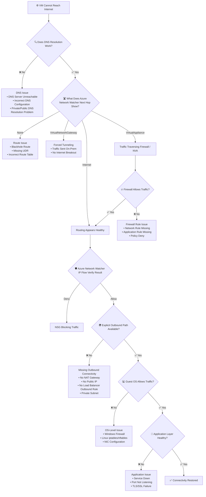

# 🚨 Root Cause Decision Tree



## 🎯 Troubleshooting Logic

```text
1. DNS
      ↓
2. Routing
      ↓
3. Firewall / NVA
      ↓
4. NSG Evaluation
      ↓
5. Outbound Connectivity Method
      ↓
6. Guest Operating System
      ↓
7. Application Layer
```

## 🔎 Quick Root Cause Mapping

| Finding | Most Likely Cause |
|----------|------------------|
| DNS lookup fails | DNS configuration issue |
| Next Hop = None | Route table/UDR issue |
| Next Hop = VirtualNetworkGateway | Forced tunneling/on-prem routing |
| No Firewall logs found | Traffic never reached firewall |
| Firewall logs show Deny | Firewall policy issue |
| IP Flow Verify = Deny | NSG rule blocking traffic |
| NSG allows traffic but internet still unavailable | Missing outbound connectivity |
| No NAT Gateway/Public IP/Outbound Rule | Explicit outbound path missing |
| Network checks pass but access still fails | Guest OS firewall or application issue |

> [!TIP]
> **Golden Rule:** Always start with DNS, then Routing, then Security Controls. Network Watcher is most effective when used to eliminate one layer at a time rather than troubleshooting everything simultaneously.