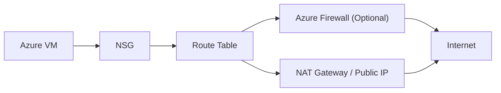
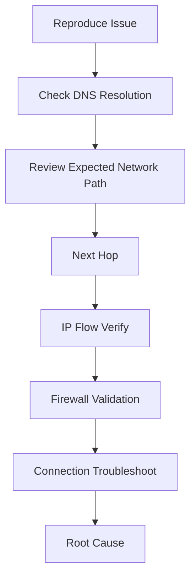

# 🌐 Scenario 01 - VM to Internet Connectivity

> **Tools:** Connection Troubleshoot · Next Hop · IP Flow Verify · Topology

---

## 🎯 Objective

Diagnose why an Azure Virtual Machine cannot reach internet endpoints and use Azure Network Watcher to determine whether the issue is caused by:

- 🛡️ Network Security Groups (NSGs)
- 🛣️ Routing (UDRs)
- 🔥 Azure Firewall
- 🌍 Missing outbound connectivity method
- 💻 Operating System firewall
- 🔍 DNS Resolution

---

## 🏗️ Architecture



---

## 📋 Reported Problem

> "The VM cannot reach internet resources."

Examples:

- Windows Update fails
- Application cannot reach external APIs
- Package downloads fail
- Browser cannot open websites
- PowerShell Gallery inaccessible
- curl requests timeout

---

# 🔍 Investigation Workflow



---

# ✅ Step 1 - Reproduce the Issue

Before opening Azure Portal, verify the issue directly from the source VM.

## Windows

```powershell
Test-NetConnection 8.8.8.8 -Port 443

Test-NetConnection google.com -Port 443

tracert 8.8.8.8
```

## Linux

```bash
curl https://www.microsoft.com

curl https://8.8.8.8

traceroute 8.8.8.8
```

---

## 📖 Understanding the Results

| Test | Purpose |
|--------|----------|
| Test-NetConnection 8.8.8.8 | Tests basic TCP connectivity |
| Test-NetConnection google.com | Tests DNS and TCP connectivity |
| tracert / traceroute | Shows path to destination |
| curl | Tests application layer connectivity |

---

# ✅ Step 2 - Validate DNS Resolution

If users are connecting using an FQDN, always test DNS first.

## Windows

```powershell
nslookup google.com

Resolve-DnsName google.com
```

## Linux

```bash
nslookup google.com

dig google.com
```

### Expected Result

```text
google.com
142.x.x.x
```

### Possible Findings

| Result | Meaning |
|----------|----------|
| No response | DNS server issue |
| Wrong IP | Incorrect DNS resolution |
| Correct IP | Continue troubleshooting |

> [!TIP]
> Many "networking issues" are actually DNS issues.

---

# ✅ Step 3 - Understand the Expected Traffic Flow

Before using Network Watcher, understand how the we expect the traffic to flow.

```text
Azure VM
    ↓
NSG
    ↓
Route Table
    ↓
Azure Firewall (Optional)
    ↓
NAT Gateway / Public IP
    ↓
Internet
```

### Questions to Ask

✅ Is Azure Firewall deployed?

✅ Is there an NVA?

✅ Is traffic forced on-premises?

✅ Is there a NAT Gateway?

✅ Does the VM have a Public IP?

✅ Is the subnet configured as a Private Subnet?

---

# ✅ Step 4 - Use Network Watcher: Next Hop 

> Microsoft provides an excellent guide on using Network Watcher to diagnose routing issues:
>
> 🔗 **[Diagnose a virtual machine routing problem using Azure Network Watcher](https://learn.microsoft.com/en-us/azure/network-watcher/diagnose-vm-network-routing-problem)**.

## Purpose

Determine how Azure plans to route traffic to the destination.

### Question

> Where is Azure sending packets destined for 8.8.8.8?

### Possible Results

| Next Hop Result | Meaning |
|-----------------|----------|
| Internet | Routing is correct |
| VirtualAppliance | Firewall/NVA in path |
| VirtualNetworkGateway | Forced tunneling |
| None | Traffic black-holed |

---

## Expected Decision Flow

```text
Internet
    ↓
Move to NSG validation

VirtualAppliance
    ↓
Inspect Firewall

VirtualNetworkGateway
    ↓
Investigate Forced Tunneling

None
    ↓
Investigate Routing
```

---

# ✅ Step 5 - Validate Outbound Connectivity Design

Modern Azure networking requires an explicit outbound connectivity method.

### Verify Whether The VM Has

- ✅ NAT Gateway
- ✅ Standard Load Balancer Outbound Rule
- ✅ Public IP Address
- ✅ Firewall performing SNAT

### Common Finding

```text
VM can resolve DNS

VM cannot reach internet

Routing appears correct

No outbound method configured
```

### Root Cause

```text
No Explicit Outbound Connectivity
```

> [!IMPORTANT]
> New Azure deployments increasingly rely on explicit outbound connectivity methods rather than platform-provided outbound access.

---

# ✅ Step 6 - Use IP Flow Verify

## Purpose

Determine whether an NSG is blocking traffic.

### Question

> Is outbound HTTPS traffic allowed?

### Example

```text
Source:
VM

Destination:
8.8.8.8

Port:
443

Direction:
Outbound
```

### Successful Result

```text
Access : Allow
Rule   : AllowInternetOutBound
```

### Failed Result

```text
Access : Deny
Rule   : Block-Internet-Out
```

---

# ✅ Step 7 - Validate Azure Firewall

Only required if Next Hop returns:

```text
VirtualAppliance
```

### Verify

- Firewall Policy
- Application Rules
- Network Rules
- Log Analytics Logs

### Key Question

> Did the packet reach Azure Firewall?

### Interpretation

| Observation | Meaning |
|------------|----------|
| No log entry | Routing problem |
| Allow entry | Continue investigation |
| Deny entry | Firewall rule issue |

---

# ✅ Step 8 - Connection Troubleshoot

Use Connection Troubleshoot as the final validation step.

### Question

> Can Azure reach the destination endpoint?

### Successful Output

```text
Connection Status : Reachable

Average Latency : 10 ms
```

### Failed Output

```text
Connection Status : Unreachable
```

---


# ✅ Common Root Causes

| Root Cause | Resolution |
|------------|------------|
| NSG Deny Rule | Modify or remove rule |
| Missing NAT Gateway | Associate NAT Gateway |
| Missing Public IP | Assign Public IP |
| Firewall Deny | Create Allow Rule |
| Forced Tunneling | Update Route Design |
| Incorrect DNS | Fix DNS Configuration |
| Windows/Linux Firewall | Allow Traffic |
| Service Not Listening | Start Application |

---

# 📝 Key Learnings

✅ Start with the VM.

✅ Validate DNS before networking.

✅ Understand the expected network path.

✅ Use Next Hop before IP Flow Verify.

✅ No Firewall Logs usually indicate a routing problem.

✅ IP Flow Verify evaluates NSGs only.

✅ A successful network test does not guarantee application health.

✅ Always document the exact rule, route, and finding that led to the root cause.

---

> [!NOTE]
> A successful Azure networking investigation should identify:
>
> 1. 📍 Where the traffic originates
> 2. 🎯 Where the traffic should go
> 3. 🛣️ What path it should take
> 4. 🚧 What component prevented the traffic from getting there