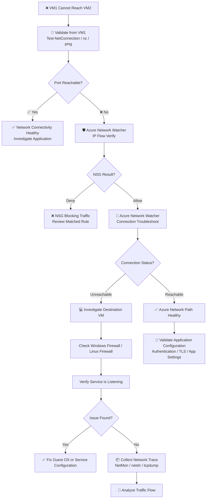

# 🚨 VM-to-VM Connectivity Decision Tree



---

## 🎯 Azure Networking Troubleshooting Flow

```text
Source VM Validation
         ↓
Azure Network Watcher - IP Flow Verify
         ↓
Azure Network Watcher - Connection Troubleshoot
         ↓
Guest OS Firewall
         ↓
Application Listening
         ↓
Network Trace Analysis
```

---

## 🔎 What Each Tool Helps Identify

| Tool | Purpose |
|--------|----------|
| 🛡️ Azure Network Watcher - IP Flow Verify | Determines whether an NSG allows or denies traffic |
| 🔎 Azure Network Watcher - Connection Troubleshoot | Validates end-to-end reachability between the VMs |
| 💻 Guest OS Checks | Identifies Windows Firewall, Linux Firewall, or service issues |
| 📦 NetMon / netsh / tcpdump | Confirms whether packets reach the destination and receive a response |

> 💡 **Golden Rule:** If **IP Flow Verify = Allow** and **Connection Troubleshoot = Reachable**, Azure networking is likely working correctly and the investigation should move to the guest OS or application layer.