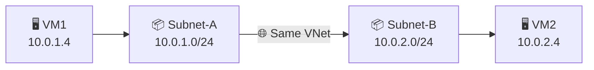

## 🔍 Investigation Steps

> [!IMPORTANT]
>
> 📚 **Microsoft Learn Reference**
>
> Azure Network Watcher Connection Troubleshoot can validate connectivity between Azure resources and help identify where communication is failing.
>
> 🔗 https://learn.microsoft.com/en-us/azure/network-watcher/connection-troubleshoot-manage?tabs=portal


## 🏗️ Architecture




---

## 🚀 Step 1 - Reproduce the Issue from VM1

Before opening the Azure Portal, verify the issue from the source VM.

### Windows

```powershell
Test-NetConnection 10.0.1.5 -Port 1433

ping 10.0.1.5

tracert 10.0.1.5
```

### Linux

```bash
nc -zv 10.0.1.5 1433

ping 10.0.1.5

traceroute 10.0.1.5
```

> [!TIP]
> Linux networking tools vary depending on the operating system and distribution.
>
> Examples:
> - Ubuntu may use `ufw`
> - RHEL/CentOS may use `firewalld`
> - Some systems use `iptables`
> - Modern distributions may use `nftables`
>
> Always verify which networking and firewall tools are installed before troubleshooting.

### 📝 Things to Observe

✅ Is the destination IP correct?

✅ Can the destination be reached?

✅ Is the expected port open?

✅ Does the issue affect all ports or only one application?

---

## 🎯 Step 2 - Confirm the Application is Running on VM2

Sometimes the network is healthy but the application itself is unavailable.

### Windows

```powershell
Get-NetTCPConnection -State Listen
```

### Linux

```bash
ss -tlnp
```

Look for:

✅ Correct listening port

✅ Application process running

✅ Service bound to the expected interface

---

## 🛡️ Step 3 - Use Network Watcher: IP Flow Verify

This should be your first Azure Network Watcher check.

### Questions Answered

- Is Azure allowing the traffic?
- Is an NSG blocking the traffic?
- Which NSG rule made the decision?

### Expected Flow

```text
Source VM      : 10.0.1.4
Destination VM : 10.0.1.5
Protocol       : TCP
Port           : 1433
```

### Typical Results

#### ✅ Allowed

```text
Access : Allow
```

Azure NSGs are not blocking the traffic.

#### ❌ Denied

```text
Access : Deny

Rule : Block-SQL-Inbound
```

An NSG is preventing communication.

> [!TIP]
> IP Flow Verify evaluates Azure networking controls only. It cannot determine whether Windows Firewall, iptables, or an application is blocking the connection.

---

## 🔎 Step 4 - Use Connection Troubleshoot

Once NSGs have been ruled out, validate end-to-end Azure connectivity.

### Questions Answered

✅ Can VM1 reach VM2?

✅ Is Azure detecting a connectivity issue?

✅ Which endpoint is failing?

### Successful Output

```text
Connection Status : Reachable
```

### Failed Output

```text
Connection Status : Unreachable
```

> [!NOTE]
> A failed Connection Troubleshoot result helps confirm a connectivity problem exists within the path, while a successful result often points you toward the guest OS or application layer.

---

## 💻 Step 5 - Validate Guest OS Firewalls

If Azure networking looks healthy, move inside the destination VM.

### Windows

```powershell
Get-NetFirewallProfile

Get-NetFirewallRule
```

### Linux

```bash
sudo iptables -L

sudo ufw status

sudo firewall-cmd --list-all
```

Common findings:

- Windows Defender Firewall blocking inbound traffic
- iptables drop rules
- firewalld restrictions
- Application-specific access controls

---

## 📦 Step 6 - Collect a Network Trace (Advanced)

If the issue remains unclear, capture packets from the operating system.

Microsoft generally recommends collecting traces from the operating system itself for detailed analysis.

### Windows

```powershell
netsh trace start capture=yes
```

### Linux

```bash
sudo tcpdump -i any host 10.0.1.5
```

Useful questions:

✅ Did the packet arrive?

✅ Did the destination respond?

✅ Was the connection reset?

✅ Is the application responding correctly?

---

## 🎓 Key Learning

A simple troubleshooting workflow for VM-to-VM communication is:

```text
Validate from VM1
        ↓
Verify Destination IP & Port
        ↓
IP Flow Verify
        ↓
Connection Troubleshoot
        ↓
Guest OS Firewall
        ↓
Application Service
        ↓
Packet Capture (if required)
```

> 💡 **Golden Rule:** If Azure networking says **Allow** and the connection still fails, start looking inside the destination VM.