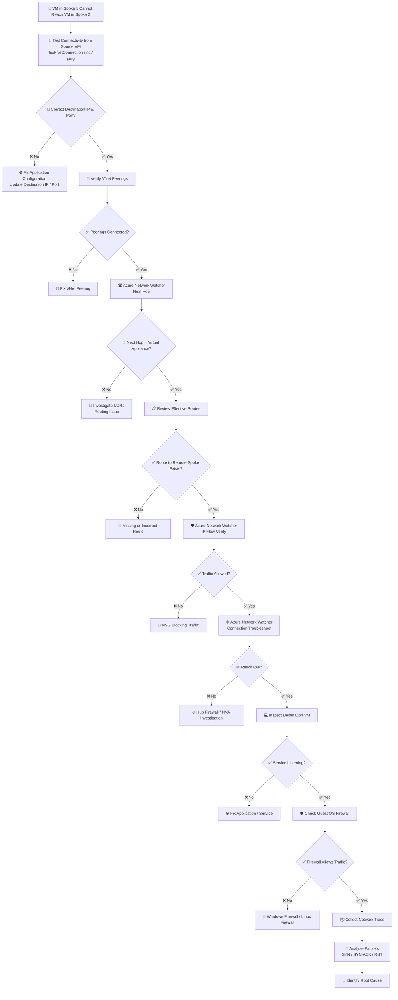

# 🚨 Hub-and-Spoke Connectivity Decision Tree



---

## 🎮 Fast-Track Troubleshooting Path

```text
🚨 Connectivity Issue
        ↓
🧪 Test from Source VM
        ↓
🔗 Verify Peering
        ↓
🛣️ Next Hop
        ↓
📋 Effective Routes
        ↓
🛡️ IP Flow Verify
        ↓
🌐 Connection Troubleshoot
        ↓
💻 Guest OS
        ↓
📦 Packet Capture
```

---

## 🔍 Quick Root Cause Mapping

| Symptom | Most Likely Cause |
|----------|----------|
| Peering not Connected | VNet peering issue |
| Next Hop ≠ VirtualAppliance | Routing/UDR issue |
| No route to remote spoke | Missing Effective Route |
| IP Flow Verify = Deny | NSG issue |
| Connection Troubleshoot = Unreachable | Routing, Firewall, or Peering issue |
| Forward works, return fails | Asymmetric routing / return path issue |
| Reachable but application fails | Guest OS or application issue |
| Traffic arrives but no response | Service not listening |
| Traffic blocked on VM | Windows/Linux firewall |

---

> [!TIP]
>
> 🧠 **Golden Rule for Hub-and-Spoke Troubleshooting**
>
> Always verify the path in **both directions**:
>
> ```text
> Spoke 1 ➜ Hub ➜ Spoke 2 ✅
>
> Spoke 2 ➜ Hub ➜ Spoke 1 ✅
> ```
>
> Most Hub-and-Spoke issues are not caused by the forward path, but by a missing **return route**, disabled **Allow Forwarded Traffic**, or an incorrect **UDR association**.