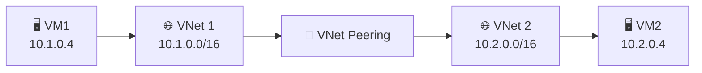

## 🔍 Investigation Steps

> [!IMPORTANT]
>
> 📚 **Microsoft Learn Reference**
>
> Azure Network Watcher provides multiple tools that can help identify routing, connectivity, and NSG-related issues between resources across peered virtual networks.
>
> 🔗 https://learn.microsoft.com/en-us/azure/network-watcher/connection-troubleshoot-manage?tabs=portal


## 🏗️ Architecture




---

## 🚀 Step 1 - Reproduce the Issue from Spoke 1 VM

Before checking Azure resources, verify the issue from the source VM.

### Windows

```powershell
Test-NetConnection 10.2.0.4 -Port 443

ping 10.2.0.4

tracert 10.2.0.4
```

### Linux

```bash
nc -zv 10.2.0.4 443

ping 10.2.0.4

traceroute 10.2.0.4
```

> [!TIP]
>
> Linux networking commands and firewall tools vary depending on the operating system and distribution being used.
>
> Common tools include:
>
> - `iptables`
> - `nftables`
> - `firewalld`
> - `ufw`
>
> Always identify the operating system and firewall technology in use before troubleshooting.

### 📝 Things to Observe

✅ Is the destination IP correct?

✅ Is the expected port reachable?

✅ Is the issue occurring for all ports or only a specific application?

✅ Does the path stop immediately or reach intermediate hops?

✅ Can the destination VM be reached using both IP address and hostname (if DNS is involved)?

---

## 🏗️ Step 2 - Understand the Expected Traffic Path

Before using Network Watcher, map the expected communication path.

```text
Spoke 1 VM
      ↓
Spoke 1 Route Table
      ↓
Hub Firewall / NVA
      ↓
Spoke 2 Route Table
      ↓
Spoke 2 VM
```

### Questions to Ask

✅ Are both VNets peered?

✅ Is peering showing a Connected state?

✅ Is Allow Forwarded Traffic enabled?

✅ Is a Firewall or NVA forwarding the traffic?

✅ Are UDRs present on both spokes?

✅ Is there any overlapping IP address space?

✅ Is there an expected return path?

> [!IMPORTANT]
>
> Remember that VNet peering is **not transitive**.
>
> Traffic from Spoke 1 to Spoke 2 typically requires:
>
> - Hub routing
> - UDRs
> - Firewall/NVA forwarding
> - A valid return path

---

## 🛣️ Step 3 - Use Azure Network Watcher: Next Hop

> [!IMPORTANT]
>
> 📚 **Microsoft Learn - Next Hop**
>
> Learn how Azure determines where traffic is routed and how to identify routing issues caused by UDRs, peerings, virtual appliances, or gateways.
>
> 🔗 https://learn.microsoft.com/en-us/azure/network-watcher/diagnose-vm-network-routing-problem

### Questions Answered

✅ Where is Azure sending the traffic?

✅ Is traffic reaching the hub?

✅ Is the correct route being used?

✅ Is routing configured as expected?

### Validate from Spoke 1

```text
Source:
10.1.0.4

Destination:
10.2.0.4
```

### Healthy Result

```text
Next Hop Type:
VirtualAppliance
```

### Potential Results

| Result | Meaning |
|----------|----------|
| VirtualAppliance | Expected in most hub-spoke deployments |
| None | Missing route / blackhole route |
| Internet | Incorrect routing |
| VnetLocal | Routing bypasses hub design |

> [!IMPORTANT]
>
> Next Hop is a directional check.
>
> Always validate:
>
> - Spoke 1 ➜ Spoke 2
> - Spoke 2 ➜ Spoke 1
>
> to verify both forward and return paths.

---

## 🔎 Step 4 - Review Effective Routes

Effective Routes show how Azure is making routing decisions for a VM NIC.

### Verify

✅ Route exists for the remote spoke subnet

✅ Route is Active

✅ Correct Virtual Appliance IP is configured

✅ No unexpected routes override the expected behavior

### Example

```text
Address Prefix:
10.2.0.0/16

Next Hop Type:
VirtualAppliance

Next Hop IP:
10.0.0.4
```

### Things to Look For

✅ Missing spoke route

✅ Unexpected Internet route

✅ Incorrect Virtual Appliance IP

✅ Route conflicts

---

## 🛡️ Step 5 - Use Azure Network Watcher: IP Flow Verify

> [!IMPORTANT]
>
> 📚 **Microsoft Learn - IP Flow Verify**
>
> IP Flow Verify evaluates Azure NSG rules and identifies which rule allows or denies traffic.
>
> 🔗 https://learn.microsoft.com/en-us/azure/network-watcher/ip-flow-verify-overview

### Questions Answered

✅ Is Azure allowing the traffic?

✅ Is an NSG blocking communication?

✅ Which NSG rule made the decision?

### Expected Flow

```text
Source VM:
10.1.0.4

Destination VM:
10.2.0.4

Protocol:
TCP

Port:
443
```

### Example Results

#### ✅ Allowed

```text
Access : Allow
```

#### ❌ Denied

```text
Access : Deny

Rule :
Block-Spoke-Traffic
```

> [!TIP]
>
> IP Flow Verify only validates Azure NSGs.
>
> It cannot identify:
>
> - Windows Firewall issues
> - Linux firewall issues
> - Firewall appliance rules
> - Application problems

---

## 🌐 Step 6 - Use Azure Network Watcher: Connection Troubleshoot

> [!IMPORTANT]
>
> 📚 **Microsoft Learn - Connection Troubleshoot**
>
> Connection Troubleshoot validates end-to-end connectivity between Azure resources and helps identify where communication is failing.
>
> 🔗 https://learn.microsoft.com/en-us/azure/network-watcher/connection-troubleshoot-manage?tabs=portal

> [!TIP]
>
> Hub-and-spoke issues are frequently caused by return-path problems or asymmetric routing.
>
> Run the test from both directions whenever possible.

### Questions Answered

✅ Can Spoke 1 reach Spoke 2?

✅ Can Spoke 2 reach Spoke 1?

✅ Is Azure identifying a connectivity issue?

✅ Does Azure see a reachable network path?

### Test Both Directions

```text
Spoke 1 VM
      ↓
Spoke 2 VM
```

and

```text
Spoke 2 VM
      ↓
Spoke 1 VM
```

### Healthy Result

```text
Connection Status : Reachable
```

### Common Findings

| Result | Possible Cause |
|----------|----------|
| Reachable from both directions | Azure networking appears healthy |
| Unreachable from both directions | Routing, Peering, NVA, or Firewall issue |
| Forward path works but return path fails | Missing return route |
| One direction only fails | Asymmetric routing |
| Reachable but application still fails | OS or application layer issue |

> [!IMPORTANT]
>
> A successful forward path does not automatically mean the return path is healthy.
>
> Always validate connectivity in both directions before ruling out Azure networking.

---

## 💻 Step 7 - Validate the Destination VM

If Azure networking appears healthy, investigate the destination VM.

### Windows

```powershell
Get-NetFirewallProfile

Get-NetTCPConnection -State Listen
```

### Linux

```bash
sudo ss -tlnp

sudo iptables -L

sudo firewall-cmd --list-all
```

### Verify

✅ Windows Defender Firewall rules

✅ Linux firewall rules

✅ Application process is running

✅ Service is listening on the expected port

✅ Service is bound to the correct interface

> [!TIP]
>
> If:
>
> - Next Hop looks correct
> - Effective Routes look correct
> - IP Flow Verify returns Allow
> - Connection Troubleshoot returns Reachable
>
> then the investigation should move inside the VM.

---

## 📦 Step 8 - Collect Network Traces (Advanced)

If the root cause is still unclear, collect packet captures for deeper analysis.

Microsoft generally recommends collecting traces directly from the operating system.

### Windows

```powershell
netsh trace start capture=yes
```

### Linux

```bash
sudo tcpdump -i any host 10.2.0.4
```

### Questions to Answer

✅ Did the packet reach the destination?

✅ Did the destination respond?

✅ Was the TCP handshake completed?

✅ Was the connection reset?

✅ Is the application responding correctly?

---

## 🎓 Key Learnings

✅ VNet peering is not transitive.

✅ Spoke-to-spoke communication requires routing through the hub.

✅ Always validate both forward and return paths.

✅ Start with Next Hop to understand Azure's routing decision.

✅ Effective Routes help explain why Azure chose a particular path.

✅ IP Flow Verify validates NSG behavior.

✅ Connection Troubleshoot validates end-to-end Azure connectivity.

✅ If Azure networking appears healthy, continue the investigation inside the operating system and application layers.

✅ Packet captures should generally be the final troubleshooting step after Azure networking checks are completed.