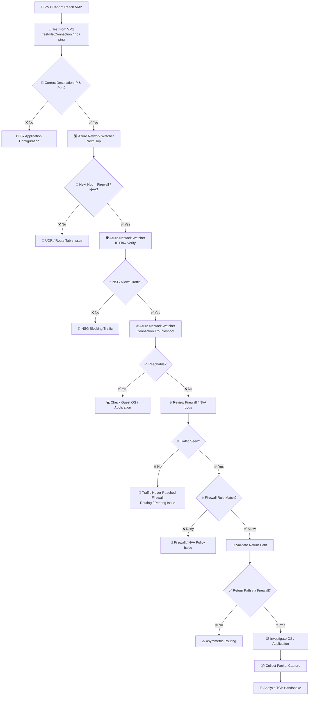

# 🚨 Firewall / NVA Connectivity Decision Tree



---

## 🎯 Recommended Troubleshooting Flow

```text
Source VM Validation
         ↓
Azure Network Watcher - Next Hop
         ↓
Azure Network Watcher - IP Flow Verify
         ↓
Azure Network Watcher - Connection Troubleshoot
         ↓
Firewall / NVA Logs
         ↓
Return Path Validation
         ↓
Guest OS Validation
         ↓
Packet Capture
```

---

## 🔍 Quick Root Cause Mapping

| Finding | Likely Root Cause |
|----------|------------------|
| Next Hop ≠ VirtualAppliance | UDR issue |
| Next Hop = None | Missing route |
| IP Flow Verify = Deny | NSG blocking traffic |
| Connection Troubleshoot = Unreachable | Routing or Firewall issue |
| No Firewall Logs | Traffic never reached Firewall/NVA |
| Firewall Log = Deny | Firewall policy issue |
| Firewall Log = Allow but traffic still fails | Return path issue |
| One-way communication | Asymmetric routing |
| Reachable but application fails | Guest OS or Application issue |
| SYN reaches destination but no reply | OS Firewall / Service issue |

---

> [!TIP]
>
> 🧠 **Golden Rule**
>
> For any hub-spoke deployment using Azure Firewall or an NVA:
>
> ```text
> VM1
>   ↓
> Firewall / NVA ✅
>   ↓
> VM2 ✅
>
> VM2
>   ↓
> Firewall / NVA ✅
>   ↓
> VM1 ✅
> ```
>
> Both the forward path and return path must traverse the same inspection device. Most "it works one way" issues are caused by missing UDRs or asymmetric routing.