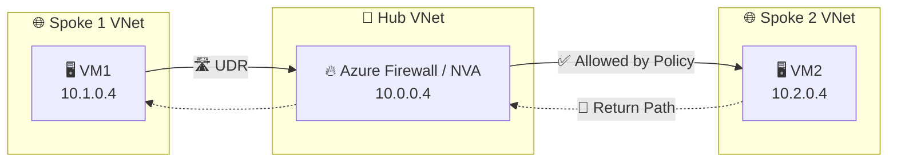

## 🔍 Investigation Steps

> [!IMPORTANT]
>
> 📚 **Microsoft Learn - Azure Network Watcher Overview**
>
> Azure Network Watcher provides tools such as Next Hop, IP Flow Verify, Topology and Connection Troubleshoot to diagnose Azure networking issues.
>
> 🔗 https://learn.microsoft.com/en-us/azure/network-watcher/network-watcher-monitoring-overview


## 🏗️ Architecture



---

## 🚀 Step 1 - Reproduce the Issue from VM1

Before reviewing firewall rules, validate the issue from the source VM.

### Windows

```powershell
Test-NetConnection 10.2.0.4 -Port 443

ping 10.2.0.4

tracert 10.2.0.4
```

### Linux

```bash
nc -zv 10.2.0.4 443

ping 10.2.0.4

traceroute 10.2.0.4
```

### 📝 Things to Observe

✅ Correct destination IP

✅ Correct destination port

✅ Is the issue affecting all ports or only one application?

✅ Does traffic stop immediately or partially traverse the path?

---

## 🛣️ Step 2 - Use Azure Network Watcher: Next Hop

> [!IMPORTANT]
>
> 📚 **Microsoft Learn - Next Hop**
>
> Learn how Azure determines the next routing decision for a packet.
>
> 🔗 https://learn.microsoft.com/en-us/azure/network-watcher/diagnose-vm-network-routing-problem

### Questions Answered

✅ Is traffic being sent to the firewall?

✅ Are the UDRs applied correctly?

✅ Is traffic bypassing the firewall?

### Expected Result

```text
Next Hop Type:
VirtualAppliance

Next Hop IP:
10.0.0.4
```

### Validate From

```text
VM1 ➜ VM2
```

and

```text
VM2 ➜ VM1
```

### Common Findings

| Result | Meaning |
|----------|----------|
| VirtualAppliance | Expected |
| Internet | UDR issue |
| VnetLocal | Firewall bypassed |
| None | Missing route |

> [!TIP]
> If Next Hop does not show the firewall or NVA, the firewall cannot inspect the traffic.

---

## 🛡️ Step 3 - Use Azure Network Watcher: IP Flow Verify

> [!IMPORTANT]
>
> 📚 **Microsoft Learn - IP Flow Verify**
>
> IP Flow Verify helps identify whether Azure NSGs are allowing or denying traffic and shows the exact matching rule.
>
> 🔗 https://learn.microsoft.com/en-us/azure/network-watcher/ip-flow-verify-overview

### Questions Answered

✅ Is an NSG blocking traffic?

✅ Which rule is evaluated?

✅ Does Azure allow the traffic to reach the firewall?

### Example Flow

```text
Source:
10.1.0.4

Destination:
10.2.0.4

Protocol:
TCP

Port:
443
```

### Results

#### ✅ Allow

```text
Access : Allow
```

#### ❌ Deny

```text
Access : Deny

Rule : Block-Spoke-Traffic
```

> [!NOTE]
> IP Flow Verify evaluates Azure NSG policies only. It does not evaluate Azure Firewall policies or NVA rules.

---

## 🌐 Step 4 - Use Azure Network Watcher: Connection Troubleshoot

> [!IMPORTANT]
>
> 📚 **Microsoft Learn - Connection Troubleshoot**
>
> Validate end-to-end connectivity between Azure resources.
>
> 🔗 https://learn.microsoft.com/en-us/azure/network-watcher/connection-troubleshoot-manage?tabs=portal

### Questions Answered

✅ Can VM1 reach VM2?

✅ Can VM2 reach VM1?

✅ Is Azure detecting a connectivity issue?

✅ Is the route functioning as expected?

### Validate Both Directions

```text
VM1 ➜ VM2
```

```text
VM2 ➜ VM1
```

### Common Findings

| Result | Interpretation |
|----------|----------|
| Reachable | Azure path healthy |
| Unreachable | Routing, Firewall, or NVA issue |
| One-way communication | Return-path issue |
| Reachable but app fails | Guest OS or application issue |

---

## 🔥 Step 5 - Review Azure Firewall or NVA Logs

### Azure Firewall

📚 Microsoft Learn

🔗 https://learn.microsoft.com/en-us/azure/firewall/monitor-firewall

### Questions Answered

✅ Did the firewall receive traffic?

✅ Was traffic allowed?

✅ Was traffic denied?

✅ Which rule collection processed the request?

### Typical Findings

| Observation | Meaning |
|------------|----------|
| No log entry | Traffic never reached firewall |
| Allow | Firewall permits traffic |
| Deny | Missing or incorrect firewall rule |
| Wrong rule match | Policy configuration issue |

---

### NVA Validation

For third-party NVAs:

✅ Verify packet counters

✅ Verify policy matches

✅ Verify route advertisements

✅ Verify IP forwarding is enabled

✅ Review vendor logs

---

## 💻 Step 6 - Validate the Destination VM

If Azure networking and firewall validation are successful, investigate the destination directly.

### Windows

```powershell
Get-NetFirewallProfile

Get-NetTCPConnection -State Listen
```

### Linux

```bash
sudo ss -tlnp

sudo iptables -L

sudo firewall-cmd --list-all
```

### Verify

✅ Guest firewall

✅ Listening port

✅ Application process

✅ Service binding

---

## 📦 Step 7 - Collect Network Traces (Advanced)

Only perform this step after Azure networking and firewall validation have been completed.

### Windows

```powershell
netsh trace start capture=yes
```

### Linux

```bash
sudo tcpdump -i any host 10.2.0.4
```

### Questions to Answer

✅ Did the packet reach VM2?

✅ Was a response generated?

✅ Was the TCP handshake completed?

✅ Is asymmetric routing occurring?

✅ Is the application responding correctly?


## 🎓 Key Learnings

✅ Always validate routing before reviewing firewall policies.

✅ Next Hop should return `VirtualAppliance`.

✅ Use IP Flow Verify to eliminate NSG-related issues early.

✅ Connection Troubleshoot should be run from both directions.

✅ No firewall log entry usually indicates a routing problem.

✅ A firewall Allow action does not guarantee application connectivity.

✅ Always verify return-path routing when Azure Firewall or an NVA is involved.

✅ Packet captures should be the final troubleshooting step.