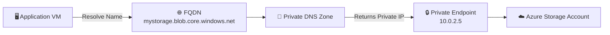

## 🔍 Investigation Steps

> [!IMPORTANT]
>
> 📚 **Microsoft Learn - Network Watcher Overview**
>
> Azure Network Watcher provides tools such as Connection Troubleshoot, IP Flow Verify, Next Hop, and Topology for diagnosing Azure networking issues.
>
> 🔗 https://learn.microsoft.com/en-us/azure/network-watcher/network-watcher-monitoring-overview


## 🏗️ Architecture



---

## 🚀 Step 1 - Reproduce the Issue from the VM

Before investigating Azure resources, validate the issue from the source VM.

### Windows

```powershell
Test-NetConnection mystorage.blob.core.windows.net -Port 443

Resolve-DnsName mystorage.blob.core.windows.net

nslookup mystorage.blob.core.windows.net
```

### Linux

```bash
nc -zv mystorage.blob.core.windows.net 443

nslookup mystorage.blob.core.windows.net

dig mystorage.blob.core.windows.net
```

### 📝 Things to Observe

✅ Is the FQDN resolving?

✅ Does the FQDN resolve to a Private Endpoint IP?

✅ Does the TCP connection succeed?

✅ Is the issue DNS-related or connectivity-related?

---

## 🌐 Step 2 - Validate DNS Resolution First

> [!IMPORTANT]
>
> Most Private Endpoint issues are DNS issues rather than network connectivity problems.

### Expected Resolution Path

```text
mystorage.blob.core.windows.net
        ↓
privatelink.blob.core.windows.net
        ↓
10.x.x.x (Private IP)
```

### Healthy Result

```text
Name:
mystorage.blob.core.windows.net

Address:
10.0.2.5
```

### Common Findings

| Result | Meaning |
|----------|----------|
| Private IP | DNS looks healthy |
| Public IP | Private DNS is missing or not linked |
| NXDOMAIN | DNS record missing |
| Timeout | DNS server issue |

> [!TIP]
> The single most valuable troubleshooting datapoint is:
>
> **"What IP address did the FQDN resolve to?"**

---

## 🏗️ Step 3 - Verify Private Endpoint Configuration

Review the Private Endpoint configuration.

### Verify

✅ Correct PaaS resource

✅ Correct sub-resource

✅ Private Endpoint connection approved

✅ Private Endpoint deployed in the expected VNet

✅ Expected private IP assigned

### Common Sub-Resources

| Service | Sub Resource |
|----------|-------------|
| Storage Blob | blob |
| Storage File | file |
| Azure SQL | sqlServer |
| Key Vault | vault |

> [!WARNING]
> Creating a Private Endpoint for the wrong sub-resource is a common issue.

---

## 📛 Step 4 - Verify Private DNS Configuration

Validate the Private DNS Zone.

### Verify

✅ Correct Private DNS Zone

✅ VNet Link exists

✅ A Record exists

✅ Correct private IP is registered

### Common Private DNS Zones

| Service | Private DNS Zone |
|----------|-------------|
| Storage Blob | privatelink.blob.core.windows.net |
| Azure SQL | privatelink.database.windows.net |
| Key Vault | privatelink.vaultcore.azure.net |

### Common Findings

| Finding | Root Cause |
|----------|----------|
| Zone Missing | DNS Resolution Failure |
| VNet Link Missing | VM cannot resolve Private Endpoint |
| Missing A Record | Name resolution failure |
| Incorrect A Record | Traffic sent to wrong endpoint |

---

## 🛣️ Step 5 - Use Azure Network Watcher: IP Flow Verify

> [!IMPORTANT]
>
> 📚 **Microsoft Learn - IP Flow Verify**
>
> Determines whether NSG rules allow or deny traffic.
>
> 🔗 https://learn.microsoft.com/en-us/azure/network-watcher/ip-flow-verify-overview

### Questions Answered

✅ Is an NSG blocking connectivity?

✅ Which NSG rule is evaluated?

✅ Is traffic allowed to the Private Endpoint?

### Example Flow

```text
Source:
VM

Destination:
10.0.2.5

Protocol:
TCP

Port:
443
```

### Results

```text
Access : Allow
```

or

```text
Access : Deny
```

> [!NOTE]
> IP Flow Verify evaluates Azure NSGs only.
>
> It does not evaluate:
>
> - Storage Account Firewalls
> - Azure SQL Firewalls
> - Key Vault Access Restrictions

---

## 🌐 Step 6 - Use Azure Network Watcher: Connection Troubleshoot

> [!IMPORTANT]
>
> 📚 **Microsoft Learn - Connection Troubleshoot**
>
> Validate connectivity from the VM to the FQDN or destination IP.
>
> 🔗 https://learn.microsoft.com/en-us/azure/network-watcher/connection-troubleshoot-manage?tabs=portal

### Questions Answered

✅ Can the VM reach the destination?

✅ Is Azure detecting a connectivity issue?

✅ Which destination IP is being tested?

### Validate

```text
Source:
Application VM

Destination:
mystorage.blob.core.windows.net

Port:
443
```

### Common Findings

| Result | Interpretation |
|----------|----------|
| Reachable | Network path healthy |
| Unreachable | Connectivity issue |
| Reachable to Public IP | DNS issue |
| Reachable to Private IP | Expected behavior |

> [!TIP]
> Always verify which IP Connection Troubleshoot is actually testing.

---

## 🗺️ Step 7 - Review Azure Network Watcher: Topology

> [!IMPORTANT]
>
> 📚 **Microsoft Learn - Topology**
>
> Visualizes Azure networking resources and relationships.
>
> 🔗 https://learn.microsoft.com/en-us/azure/network-watcher/view-network-topology

### Questions Answered

✅ Does the Private Endpoint exist?

✅ Is it deployed in the expected subnet?

✅ Are the VM and Private Endpoint in connected networks?

✅ Are required resources present?

---

## 💻 Step 8 - Validate PaaS-Specific Access Controls

Connectivity may be healthy while the platform service blocks requests.

### Verify

#### Azure Storage

✅ Public Network Access

✅ Firewall Rules

✅ Network Rules

#### Azure SQL

✅ Firewall Rules

✅ Private Endpoint Approval

#### Azure Key Vault

✅ Network ACLs

✅ Firewall Configuration

✅ Access Policies / RBAC

---

## 📦 Step 9 - Collect Network Traces (Advanced)

Only perform this step after DNS and Azure networking validation.

### Windows

```powershell
netsh trace start capture=yes
```

### Linux

```bash
sudo tcpdump -i any host 10.0.2.5
```

### Questions to Answer

✅ Is the VM connecting to the expected IP?

✅ Is traffic reaching the Private Endpoint?

✅ Is a response returned?

✅ Is the TLS handshake completing?

---

## 🎓 Key Learnings

✅ DNS should always be validated before networking.

✅ Private Endpoint issues are frequently DNS-related.

✅ Always verify the resolved IP address.

✅ Private DNS Zone links are critical.

✅ Connection Troubleshoot validates connectivity, not DNS configuration.

✅ IP Flow Verify helps eliminate NSG-related issues.

✅ Topology helps confirm Private Endpoint placement.

✅ A successful network connection does not guarantee that the PaaS service allows access.

✅ The most common root cause is DNS resolving to the public endpoint instead of the private endpoint.